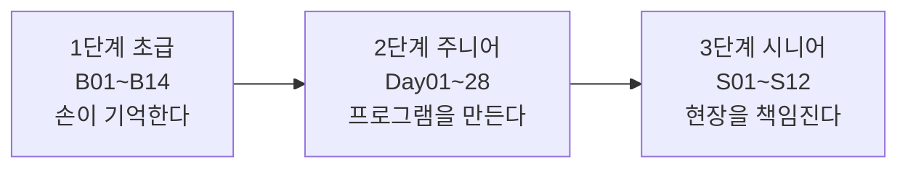
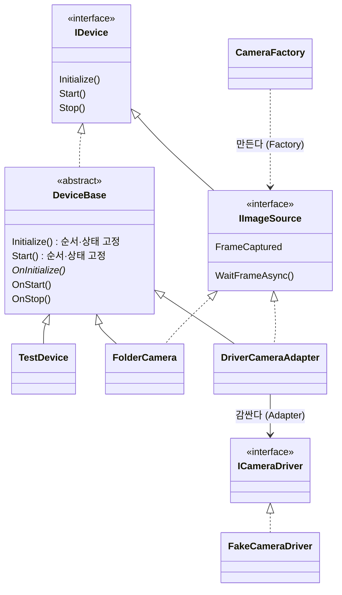

# MiniSight · 시니어 SW 필드엔지니어로 가는 복습 여정

> FA 현장에서 C# 비전 검사 프로그램을 운영하고 고쳐 온 엔지니어가 **손코딩 기본기부터 다시 쌓아 올리는** 공개 학습 기록입니다.

## 왜 다시 시작했나

현장 엔지니어로 일하며 C# 비전 검사 프로그램을 **읽고, 고치고, 현장에 세우는 일**은 많이 해 왔습니다.
최근에는 AI 도구와 함께 빠르게 결과물을 만드는 방식(이른바 바이브코딩)에 익숙해졌는데, 그만큼 **코드를 처음부터 직접 쓰는 감각과 "왜 이렇게 써야 하는지" 설명하는 힘이 무뎌졌다**고 느꼈습니다.

그래서 복습 차원에서 빈자리를 채우기로 했습니다.
**키워드 하나에 작은 Kata 하나**를 직접 타이핑하는 것부터 시작해, 그 재료로 작은 검사 프로그램 **MiniSight**를 만들고, 마지막에는 현장을 책임지는 시니어 필드엔지니어의 일(장애 분석, 배포·롤백, 이식, 현장 문서)까지 연습합니다.

## 학습 원칙

| 원칙 | 내용 |
|---|---|
| ✍️ 복사·붙여넣기 금지 | Kata마다 **3번 타이핑**: 보면서 → 실행 결과 비교 → 지우고 안 보고 |
| 💥 일부러 망가뜨리기 | Kata마다 **바꿔 보기** 1개: 코드를 고장 내고 컴파일 에러·예외를 직접 확인 |
| 🗣️ 말로 설명하기 | 셀프 체크 문항에 내 말로 답하고, 틀린 부분은 그대로 기록 |
| 🤖 AI는 튜터로만 | AI에게 정답 코드를 받지 않고, **설명·질문·코드 리뷰**만 받습니다. 타이핑과 디버깅은 직접 |
| 📝 정직한 기록 | 막힌 곳과 오해한 것을 [진도 기록](Study/PROGRESS.md)에 남기고, 나중에 다시 확인 |
| 🔁 Kata 하나 = 커밋 하나 | Kata를 통과할 때마다 진도 기록과 코드를 커밋 |

## 로드맵: 초급 → 주니어 → 시니어

| 단계 | 기간(목표) | 다루는 것 | 졸업 기준 | 상태 |
|---|---|---|---|---|
| **1 초급** | 1~2주 | `?.` `??` `=>`, 상속, 람다, 이벤트, `using`, 컬렉션, LINQ, 바이트·엔디언, `Task`, 취소, `lock` | 가짜 카메라 50줄을 안 보고 15분 안에 작성 | 🟠 진행 중 (4/14) |
| **2 주니어** | 약 5주 | 디자인 패턴(Template Method, Factory, Adapter, Facade, Strategy), 멀티스레드 파이프라인, 영상처리, UI 스레드, TCP 통신, 비동기 로그, 테스트 | MiniSight가 가짜 장치로 촬영 → 검사 → 결과 송신 → 로그 → 안전 종료까지 동작 | ⚪ 대기 |
| **3 시니어** | 약 6주 | Modbus TCP·시리얼, 장애 재현과 덤프 분석, 장기 구동 테스트, 성능·택트, 배포·롤백, CI, 골든 테스트, 현장 문서, ADR | 처음 보는 장애를 1시간 안에 재현·분석·보고 / 이식 계획 15분 설명 / v1.0 릴리스 | ⚪ 대기 |

자세한 계획: [Study/00-Roadmap.md](Study/00-Roadmap.md) · 현장 역량 지도: [Study/FieldSkills.md](Study/FieldSkills.md)

## 지금까지의 기록

| 날짜 | 한 것 | 배운 점 / 바로잡은 것 |
|---|---|---|
| 2026-10-27 ~ 28 | 1회차 Day01~04: 단일 실행·전역 예외, 장치 계약, `DeviceBase`, 카메라 어댑터·팩토리 | 패턴보다 **키워드를 손으로 써 본 경험이 부족**하다는 걸 확인 → 초급 트랙을 새로 만들고 처음부터 다시 시작 |
| 2026-10-28 | B01 `?.` `??` `throw` 식 `nameof` `=>` | `set` 없는 속성에 대입하는 것을 실행 중 예외로 착각 → 컴파일 에러 **CS0200**으로 바로잡음 |
| 2026-10-29 | B02 `interface` `abstract` `virtual` `override` `base` `protected` | 인터페이스는 상속이 아니라 **구현**한다. `Speak()`를 `virtual`로 두지 않는 이유 = 자식이 **순서를 바꾸지 못하게** (Template Method의 핵심) |
| 2026-10-29 | B03 `Action` `Func` 람다 | `Func<string, int>`에 인자 2개짜리 람다를 써서 CS1593 → **꺾쇠 개수 - 1 = 람다 인자 수**. `Func<T>`는 "만드는 방법"만 담아 두고 펼칠 때마다 새 객체를 만든다 (재연결 시 새 드라이버를 받는 이유) |
| 2026-10-29 | B04 `event` `EventHandler<T>` `+=` `-=` `?.Invoke` | `event`는 바깥에서 `+=`/`-=`만 허용(`=`, 직접 호출은 CS0070). `Dispose()`는 객체를 null로 만들지 않는다 → **버리기 전에 줄(`-=`)부터 놓아야** 버린 객체가 다시 불리지 않는다 |

전체 기록과 다시 확인할 질문: [Study/PROGRESS.md](Study/PROGRESS.md)

## MiniSight 현재 구조

- **순서는 부모가, 빈칸은 자식이**: `DeviceBase`가 초기화·시작 순서와 상태 전이를 고정하고, 장치마다 다른 부분만 자식이 채웁니다 (Template Method).
- **카메라 종류를 몰라도 되게**: 검사 쪽은 `IImageSource`만 보고, 실제 드라이버는 어댑터가 같은 모양으로 감쌉니다 (Adapter + Factory).
- 장비가 없으므로 카메라·PLC는 모두 **가짜(Fake)·시뮬레이터**로 만듭니다.

## 저장소 구조

| 폴더 | 내용 |
|---|---|
| [`Katas/`](Katas) | 1단계 초급 Kata (B01~B14). 키워드별 콘솔 연습 |
| [`MiniSight/`](MiniSight) | 작은 비전 검사 프로그램 (WinForms, 장치 추상화, 카메라 어댑터·팩토리) |
| [`MiniSight.Katas/`](MiniSight.Katas) | 2단계 Day별 Kata (MiniSight 부품을 콘솔에서 시험) |
| [`Study/`](Study) | 학습 계획, Kata·Day 문서, 현장 역량 지도, 진도 기록 |

## 빌드

1. `MiniSight.sln`을 Visual Studio 2022로 엽니다.
2. 솔루션 우클릭 → **NuGet 패키지 복원**.
3. 플랫폼을 **x64**로 두고 빌드합니다. (C# 7.3 / .NET Framework 4.7.2. 현장 장비 PC와 같은 버전을 일부러 유지합니다.)
